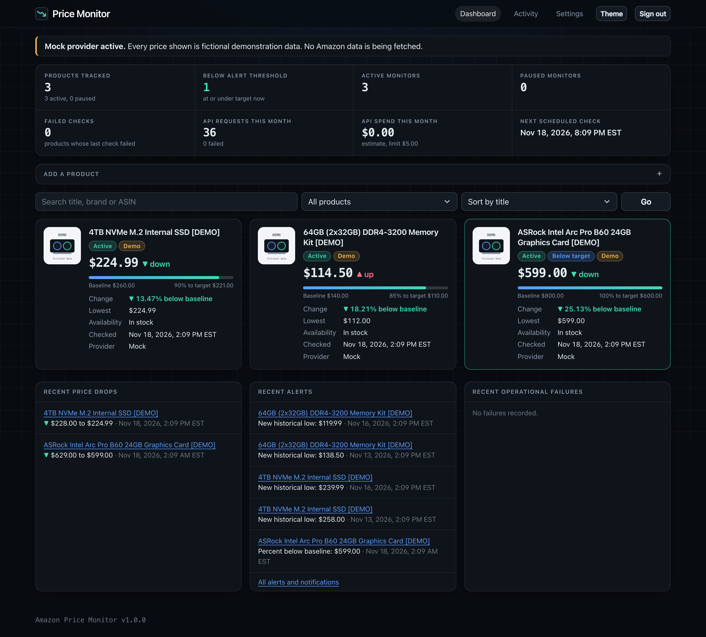
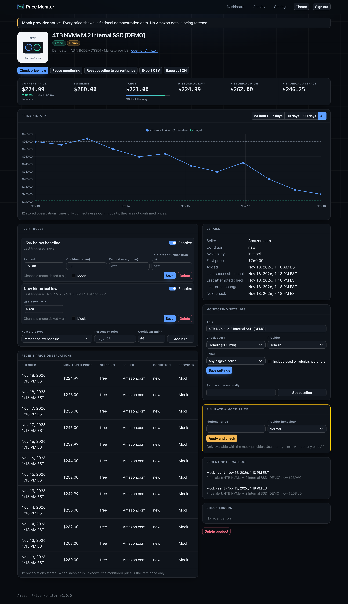
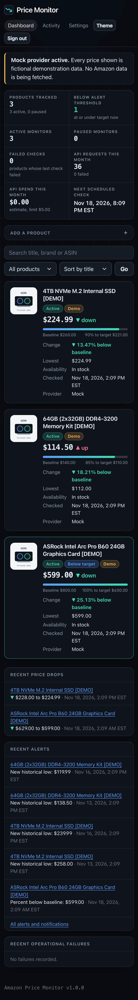
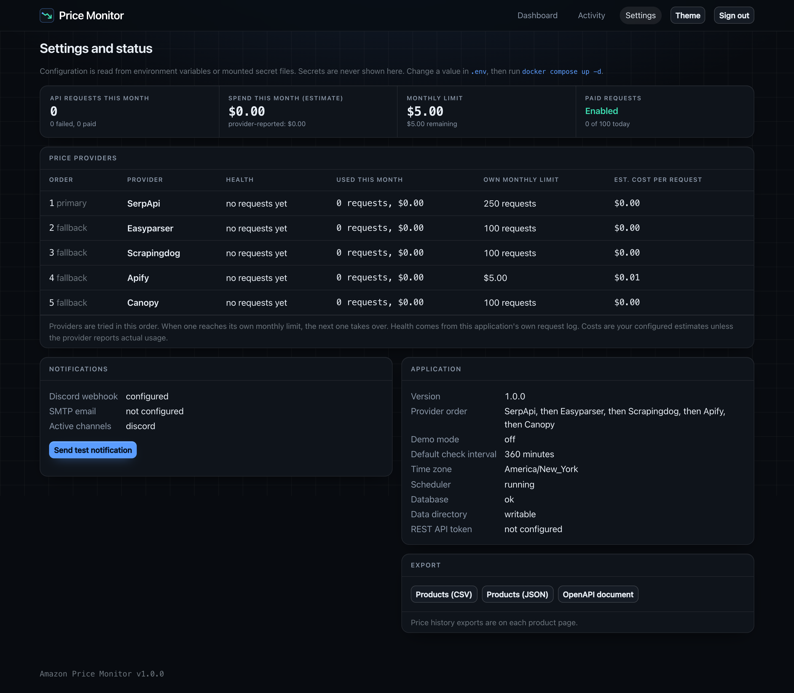
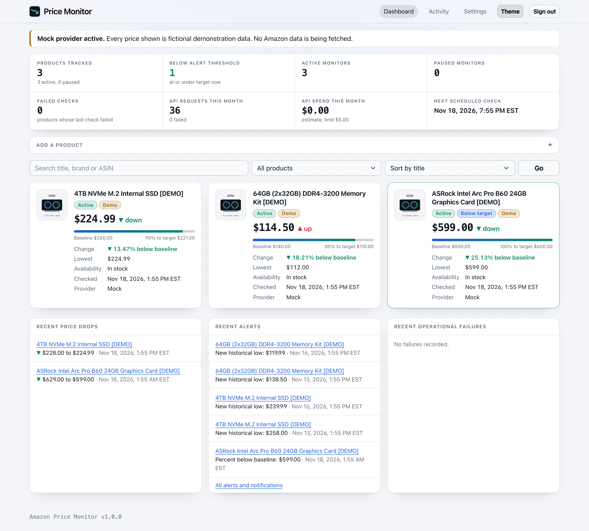

<p align="center">
  
</p>

<h1 align="center">Amazon Price Monitor</h1>

<p align="center">
  A self-hosted price tracker for Amazon products. It runs in one Docker container,<br>
  watches the prices you care about, and posts to Discord when a price hits your target.
</p>

<p align="center">
  
  
  
  
  
  
</p>



## What it does

You paste an Amazon link. The application records the current price as the baseline.
You say "tell me at 25% off". When a valid price reaches that target, you get one alert.

| | |
|---|---|
| **Track anything on amazon.com** | Product links, short links (`a.co`, `amzn.to`) or a bare ASIN. Tracking parameters are removed. |
| **Six alert types** | Percent below baseline, fixed target price, percent below the historical average, new historical low, percent drop since the last check, back in stock. |
| **No alert spam** | One alert when the price crosses the target. Silence while it stays there. A fresh alert after it recovers and drops again. Optional reminders and further-drop alerts. |
| **Accurate prices only** | Missing, zero, negative, wrong-currency, out-of-stock and used-offer prices never update history and never trigger alerts. Shipping is added when known and marked unknown when not. |
| **Second opinion on big drops** | Optionally, a sudden large drop is held until a second check, preferably from another provider, agrees. One odd reading never sends an alert. |
| **Hard spending limits** | Paid API calls are off until you enable them. Monthly budget and daily request limits are enforced before every call and survive restarts. |
| **Six price sources** | SerpApi, Easyparser, Scrapingdog, Apify, Canopy API, and a built-in mock provider that needs no account. |
| **Free plans, combined** | Give each provider its own monthly limit. Usage is spread over the month, and when one provider is at its limit the next one takes over. |
| **Test before you trust** | The Settings page sends one test request to any provider and shows exactly what came back and how it would be used. |
| **Automatic backups** | A daily database backup inside the data volume, with the last seven kept. |
| **Notifications** | Discord webhook (no bot needed), optional SMTP email. Every delivery is recorded and retried on temporary errors. |
| **Private by default** | Binds to `127.0.0.1`. Single-user login, CSRF protection, strict Content Security Policy, no telemetry, no third-party scripts. |

<table>
  <tr>
    <td width="68%"></td>
    <td width="32%"></td>
  </tr>
  <tr>
    <td align="center"><sub>Product page: price history, target line, alert rules, observations</sub></td>
    <td align="center"><sub>The same dashboard on a phone</sub></td>
  </tr>
</table>



<p align="center"><sub>Settings: the order in which providers are tried, what each has used this month, and its own limit</sub></p>

Each product card shows a **target meter**: how far the price has moved from the baseline toward your target.
Price movement is always shown with a symbol and a word (`▼ down`, `▲ up`), never with colour alone.

## Quick start

You need a Linux server (or any machine) with Docker and the Compose plugin installed.

```bash
git clone https://github.com/fm407/amazon-price-monitor.git
cd amazon-price-monitor
cp .env.example .env
docker compose up -d --build
```

Then:

1. Print the one-time setup token:
   ```bash
   docker compose logs app | grep setup_token
   ```
2. Open <http://127.0.0.1:8080>. On a headless server, forward the port first:
   `ssh -L 8080:127.0.0.1:8080 you@your-server`
3. Paste the token, choose a username and a password of at least 12 characters.

The default `.env` starts in **mock mode with demo data**. You see three clearly labelled fictional
products with price history, charts and alerts. No account and no API key are needed.
Nothing in mock mode is a real Amazon price.

## Going live

Edit `.env`, then run `docker compose up -d` again to apply the change.

**1. Choose one or more price providers**

Several providers have a free monthly plan. You can chain them, and each one stops at its own limit.

| Provider | Free plan seen on 2026-11-18 |
|---|---|
| SerpApi | 250 searches per month |
| Easyparser | 100 credits per month |
| Scrapingdog | 100 credits per month |
| Apify | $5 of usage per month |
| Canopy | reported as 100 requests per month |

```ini
PROVIDER=serpapi
FALLBACK_PROVIDER=easyparser,scrapingdog
DEMO_MODE=false

SERPAPI_API_KEY=your-key
SERPAPI_COST_PER_REQUEST_USD=0
SERPAPI_MAX_MONTHLY_REQUESTS=250

EASYPARSER_API_KEY=your-key
EASYPARSER_COST_PER_REQUEST_USD=0
EASYPARSER_MAX_MONTHLY_REQUESTS=100

SCRAPINGDOG_API_KEY=your-key
SCRAPINGDOG_COST_PER_REQUEST_USD=0
SCRAPINGDOG_MAX_MONTHLY_REQUESTS=100
```

That is about 450 free checks per month: 7 products twice a day, or 15 products once a day.
One provider is enough to start. Free plans change, so confirm the numbers on each provider's
pricing page. Details for every provider are in [docs/API_PROVIDERS.md](docs/API_PROVIDERS.md).

**2. Allow provider requests and set your limits**

```ini
ALLOW_PAID_API_REQUESTS=true
MAX_MONTHLY_API_SPEND_USD=5.00
MAX_DAILY_API_REQUESTS=100
DEFAULT_CHECK_INTERVAL_MINUTES=360
CONFIRM_DROP_PERCENT=15              # recommended when you use more than one provider
```

Then open **Settings**, choose a provider under *Test a provider*, paste an Amazon link and press
**Send one test request**. You see the price, seller and stock the provider returned.

**3. Connect Discord**

In Discord: *Server Settings > Integrations > Webhooks > New Webhook > Copy Webhook URL*.

```ini
DISCORD_WEBHOOK_URL=https://discord.com/api/webhooks/123456789/your-token
```

Open *Settings* in the dashboard and press **Send test notification**.
Step-by-step instructions are in [docs/DISCORD_SETUP.md](docs/DISCORD_SETUP.md).

## Add your first product

1. On the dashboard, open **Add a product**.
2. Paste the Amazon link, for example `https://www.amazon.com/dp/B0XXXXXXXX`.
3. Set **Alert at discount (%)** to `25`. Optionally enter a fixed target price as well.
4. Press **Add**.

The first valid price becomes the baseline. With a baseline of $800.00 and a 25% discount,
the target is $600.00. You are alerted when a valid price is $600.00 or less.

To change a rule later, open the product and edit it under **Alert rules**. There you can also
add other alert types, set a cooldown, turn on reminders, or reset the baseline.

## How much will it cost?

One check is one provider request. The number of requests per month is:

```
products x (minutes per month / check interval)
```

| Products | Interval | Requests per month |
|---:|---|---:|
| 5 | 6 hours | about 600 |
| 10 | 12 hours | about 600 |
| 20 | 24 hours | about 600 |

Multiply by your provider's price per request. The application stops paid requests when your
monthly budget or daily limit is reached, shows the reason on the dashboard, and sends one
notification per month. It stays online and resumes by itself. The spend figure is your own
estimate unless the provider reports real cost (Apify does, the others do not).

With free plans, set each provider's cost to `0` and its `MAX_MONTHLY_REQUESTS` to the plan size.
The **Settings** page shows how much of each provider's allowance is used.

## Everyday commands

| Task | Command |
|---|---|
| Start | `docker compose up -d` |
| Stop | `docker compose down` |
| Logs | `docker compose logs -f app` |
| Health | `docker compose ps` or `curl -s http://127.0.0.1:8080/api/v1/health` |
| Update | `git pull && docker compose up -d --build` |
| Back up now | `docker compose exec app python -m app backup` |
| Copy backups to the host | `docker compose cp app:/app/data/backups ./` |
| Lost password | `docker compose exec app python -m app reset-admin && docker compose restart app` |
| Run all checks | `./scripts/docker_test.sh` |

Restore, bind mounts, LAN access and more are covered in [docs/DOCKER.md](docs/DOCKER.md).

## How it is built

```
Browser --> FastAPI (one process, one worker)
              |- Dashboard (Jinja2, HTMX, Chart.js, all assets served locally)
              |- REST API  /api/v1  (OpenAPI document at /api/v1/openapi.json)
              '- Scheduler thread --> Check pipeline
                                        budget guard > provider > normalize > store > alert rules
                                        Providers: SerpApi | Easyparser | Scrapingdog | Apify | Canopy | Mock
                                        Notifiers: Discord webhook | SMTP | Mock

SQLite (WAL) on the named volume "amazon-price-monitor-data", mounted at /app/data
```

One container and one volume. No Redis, no message broker, no external database.
The schedule lives in the database (`next_check_at` per product), so a restart resumes
monitoring without duplicate jobs. Money is stored as integer minor units, never as floats.
The reasoning behind each decision is in [docs/ARCHITECTURE.md](docs/ARCHITECTURE.md).

## Documentation

| Document | Contents |
|---|---|
| [INSTALLATION](docs/INSTALLATION.md) | Fresh Ubuntu to a running dashboard |
| [CONFIGURATION](docs/CONFIGURATION.md) | Every environment variable |
| [API_PROVIDERS](docs/API_PROVIDERS.md) | Canopy, Apify, mock mode, fallback, cost controls |
| [DISCORD_SETUP](docs/DISCORD_SETUP.md) | Webhook and email notifications |
| [DOCKER](docs/DOCKER.md) | Operations, backup, restore, LAN access |
| [SECURITY](docs/SECURITY.md) | Threat model, controls, verification results |
| [TESTING](docs/TESTING.md) | How to run the tests and what they cover |
| [TROUBLESHOOTING](docs/TROUBLESHOOTING.md) | Common problems and fixes |
| [ARCHITECTURE](docs/ARCHITECTURE.md) | Components, data model, design decisions |
| [STATUS](docs/STATUS.md) | What is verified and what awaits live credentials |
| [CORRECTIONS](docs/CORRECTIONS.md) | Mistakes found during development and how they were fixed |

## Verification status

- 297 automated tests pass on macOS and inside a Linux container. Line coverage is 95%.
- The Docker script builds the image, runs the full alert scenario, restarts and recreates the
  container, and confirms that data and alert state persist.
- Dependencies are pinned with hashes. The vulnerability audit reports no known issues.

**Not yet verified with live credentials:** real responses from the five external providers, and
real Discord and SMTP delivery. These integrations follow the official API documentation and are tested
against mocked HTTP responses. See [docs/STATUS.md](docs/STATUS.md) for the exact list.

## Known limitations

- Only `amazon.com` is enabled. The data model already stores marketplace and currency per product.
- Canopy's product endpoint returns no shipping cost, so Canopy prices are item prices with shipping marked unknown.
- Coupons are shown for information and are never subtracted from the price.
- Tax is not included.
- One administrator account. No multi-user support.
- Configuration changes need a container restart.

<p align="center"></p>
<p align="center"><sub>Light theme</sub></p>
